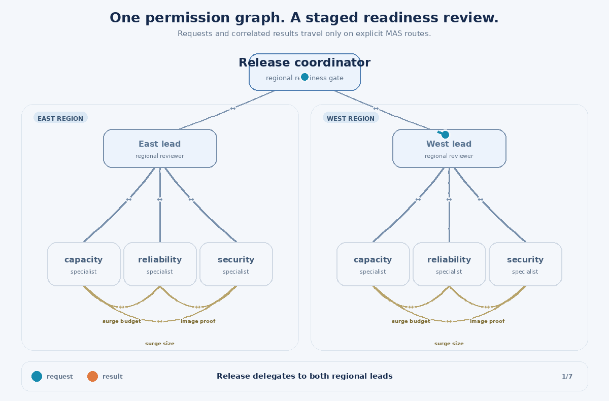

# MAS platform rollout readiness demo (Go)

A read-only, deterministic **multi-region Kubernetes rollout readiness review**
using [emmett08/mas](https://github.com/emmett08/mas). A release coordinator delegates
to regional leads, which consult capacity, reliability, and security specialists.
Specialists cross-check one another before a regional result can pass the release
gate. An unsigned image, insufficient surge capacity, or unavailable telemetry
cannot be voted away by other successful checks.

The application is Go, with no third-party Go dependencies. MAS is a **Rust
runtime**, not a Go library: this demo drives its real administrative CLI and
SQLite mailboxes. It does not reimplement the MAS protocol or use a fake bus.
The default offline mode needs no Kubernetes cluster, API keys, Python, LLMs,
or paid services. Optional Copilot CLI advisors are described below.

## Run

Requirements: Go 1.24+, Rust 1.99.0, Cargo, a C compiler (for bundled SQLite),
and Linux for the verified setup below. The demo was tested against MAS commit
[`9d9845990843f5e3464395da7bd60bb50ffb2dda`](https://github.com/emmett08/mas/commit/9d9845990843f5e3464395da7bd60bb50ffb2dda).
Other runtime revisions may change the CLI contract.

Use absolute paths for both repositories. Set `DEMO_DIR` to your checkout; the
following downloads the pinned upstream source into a fresh temporary directory:

```sh
export DEMO_DIR=/absolute/path/to/mas-demo
export MAS_SOURCE="$(mktemp -d /tmp/mas-source.XXXXXX)"
export MAS_REV=9d9845990843f5e3464395da7bd60bb50ffb2dda
curl --fail --location "https://codeload.github.com/emmett08/mas/tar.gz/$MAS_REV" \
  --output "$MAS_SOURCE/source.tar.gz"
tar -xzf "$MAS_SOURCE/source.tar.gz" -C "$MAS_SOURCE" --strip-components=1
cargo build --release --locked \
  --manifest-path "$MAS_SOURCE/rust-protocol/Cargo.toml" --bin mas
export MAS_BIN="$MAS_SOURCE/rust-protocol/target/release/mas"

go -C "$DEMO_DIR" run . -mas-bin "$MAS_BIN" -scenario healthy
```

Alternatively, supply an already-built compatible `mas` executable. When
`-mas-bin` is omitted, the executable is resolved from `PATH`.

JSON goes to stdout; the retained evidence directory is printed to stderr.
The healthy report contains `"decision": "proceed"`, two `ready` regions, six
checks with evidence, and MAS usage of **28 messages and zero external calls**.
Database paths vary, but the readiness decisions and check evidence are repeatable.

### Scenarios

```sh
go -C "$DEMO_DIR" run . -mas-bin "$MAS_BIN" -scenario capacity
go -C "$DEMO_DIR" run . -mas-bin "$MAS_BIN" -scenario unsafe-image
go -C "$DEMO_DIR" run . -mas-bin "$MAS_BIN" -scenario missing-telemetry
```

| Scenario | Changed evidence | Decision |
| --- | --- | --- |
| `healthy` | Both regions have sufficient capacity, error budget, and safe images | `proceed` |
| `capacity` | West has only 3 free pod slots; the rollout needs 4 | `hold` |
| `unsafe-image` | East's image is unsigned; security and reliability reject it | `hold` |
| `missing-telemetry` | West cannot establish its error budget or safe surge allowance | `inconclusive` |

The fixture scales from 6 to 8 replicas with 2 surge replicas, so the capacity
check needs `8 - 6 + 2 = 4` free pod slots. At least 20% error budget permits a
surge of 2; below that threshold the permitted surge is 0. Security requires a
signed, nonprivileged workload whose surge does not exceed its policy limit.
These are illustrative policies, not universal Kubernetes sizing or SLO rules.

`hold` takes precedence over `inconclusive` when both blockers and missing evidence
exist. Only all-ready checks in all regions permit `proceed`.
**All successfully evaluated scenarios exit 0**, including holds. Inspect the JSON
decision, not the process exit status, for readiness. Invalid arguments, runtime
errors, expired/incomplete tasks, and timeouts exit nonzero without a decision.

## Why combine topologies?



The arrows show bidirectional permission routes; the moving dots show request
and result traffic through the workflow.

- **Tree:** `release ↔ region-lead ↔ specialists` scopes responsibility. The
  coordinator cannot address specialists directly; regions cannot address one
  another.
- **Star:** each regional lead queues three independent readiness requests before
  collecting results. The lead assembles a regional report rather than assuming
  that one successful specialist implies overall readiness.
- **Mesh:** each regional trio has all pairwise routes. Capacity asks reliability
  for a surge allowance; reliability asks security for image attestation; security
  asks capacity for the proposed surge size. Each pair exchanges real MAS requests
  and correlated results; peer evidence affects the checks.

These patterns overlap in **one explicit directed permission graph**. Every
request route also has a reply route. Topology controls who may communicate; it
does not schedule execution. This Go host deliberately executes handlers
serially, even though star requests are queued together. It is not a concurrency
benchmark.

Each region uses seven tasks: one delegation, three specialist checks, and three
peer checks. Across two regions that is **14 tasks / 28 messages**, bounded by
100 messages, 256 KiB of cumulative wire data, mailbox capacity 8, and a 120-second
MAS deadline. Pure fixture computations do not reserve external calls. Copilot
mode reserves up to six calls and adds advisory text to the same MAS results.

For each exchange, Go asks MAS to encode the envelope, sends it, receives and
validates the exact delivery, checks request actionability, acknowledges receipt,
then executes the handler using the delivered input. Results travel back through
MAS before aggregation. The final report also requires every task to be completed
and the run not to be expired. A protocol task being `completed` means its
assessment was returned, **not** that the assessment passed.

## Inspect retained evidence

By default, each invocation creates a private temporary directory and leaves it
available for inspection. For a predictable location, supply a **new** directory:

```sh
go -C "$DEMO_DIR" run . -mas-bin "$MAS_BIN" \
  -scenario capacity -state-dir "$DEMO_DIR/.mas-state"
"$MAS_BIN" status "$DEMO_DIR/.mas-state/state.sqlite" rollout
```

The directory contains `topology.json` and the real `state.sqlite` database.
It also contains `mailbox.jsonl` (timestamped transition snapshots) and
`mailbox.md` (a human-readable mailbox/task timeline).
Status shows the frozen routes, task outcomes, usage, and delivery/acknowledgement
records. The local `.mas-state` directory and default Go binary are gitignored.
Existing directories are refused to avoid overwriting or accidentally reusing a
previous run. Move or remove evidence explicitly before reusing a directory.
Temporary evidence is not automatically cleaned up.

The Go workflow has a total timeout of 30 seconds by default; `-timeout 60s`
adjusts it, up to two minutes. On failure, inspect the printed state directory:
a timed-out subprocess may already have committed a transaction. The demo does
not automatically retry or resume an interrupted workflow. MAS mailbox
redelivery and idempotent sends do not themselves supply workflow recovery.

## Validate

```sh
go -C "$DEMO_DIR" test ./...
go -C "$DEMO_DIR" vet ./...
go -C "$DEMO_DIR" build -o /tmp/mas-rollout-demo .

# Include real-runtime integration tests (otherwise these explicitly skip):
MAS_BIN="$MAS_BIN" go -C "$DEMO_DIR" test -race -count=1 ./...
```

Unit tests cover policy boundaries, fail-closed aggregation, and graph boundaries.
Integration tests run every scenario against real MAS, verify 14 completed tasks
and empty mailboxes, test forbidden routes, idempotent sends, restart redelivery,
envelope matching, and cancelled-request rejection.

## Safety and scope

In default offline mode, all agents are deterministic Go functions under **one trusted host identity**,
using synthetic observations. No manifests are applied, no cluster is queried,
and no image signature is actually verified. This demonstrates orchestration and
evidence flow, not production deployment approval or AI reasoning.

The administrative CLI accepts the host's asserted actor; topology rejection is
not agent authentication or isolation. Do not expose this CLI, database, or host
to untrusted agents. A production extension needs MAS's capability gateway and
appropriate process isolation, independently obtained telemetry and attestations,
operation-specific validation, durable scheduling/recovery, and explicit human
approval plus idempotency/reconciliation for any external effects. Receipt,
task completion, and peer agreement do not establish truth or exactly-once
deployment.

## Optional Copilot advisors

No changes to the upstream MAS repository are required. This demo integrates
**Copilot CLI sessions**, not GitHub Copilot cloud coding agents or repository
custom-agent definitions. The Go coordinator and peer-policy checks remain
deterministic; configured specialist roles can additionally request a model's
interpretation of their delivered evidence.

Two checked-in configurations map the `capacity`, `reliability`, and `security`
roles to providers:

- `config/offline.json`: deterministic providers; no CLI, credentials, or calls.
- `config/copilot.json`: Copilot providers with explicit models, role
  instructions, per-call timeouts, AI-credit caps, and shared invocation/output
  budgets. A role may be changed to `deterministic` with an empty model and zero
  AI credits to run a mixed-provider demo.

Configuration is optional; omitting it preserves the original offline behavior.
The generated `topology.json` still defines the hybrid communication graph;
provider configuration does not grant routes or tool permissions.

```sh
go -C "$DEMO_DIR" run . -mas-bin "$MAS_BIN" \
  -agents-config "$DEMO_DIR/config/offline.json"

# Additional live prerequisite: Node.js 22+ and the pinned CLI.
# Install before exporting credentials.
npm install --prefix /tmp/mas-copilot-cli --no-audit --no-fund @github/copilot@1.0.98

# Supply COPILOT_GITHUB_TOKEN securely through your environment/secret manager.
# Do not put its value in JSON, command-line arguments, or tracked files.
go -C "$DEMO_DIR" run . -mas-bin "$MAS_BIN" \
  -copilot-bin /tmp/mas-copilot-cli/node_modules/.bin/copilot \
  -agents-config "$DEMO_DIR/config/copilot.json" -allow-live \
  -timeout 120s -scenario missing-telemetry
```

Use an account with Copilot access and a supported credential, such as a
fine-grained PAT with **Copilot Requests** permission. Classic PATs are not
supported by this CLI. The workflow's automatic `GITHUB_TOKEN` is **not** a
substitute for Copilot authorization. Model access depends on the account and
organization policies; change the configured model if `gpt-5.4` is unavailable.
See the [Copilot CLI reference](https://docs.github.com/en/copilot/reference/copilot-cli-reference/cli-command-reference).

### Execution and safety contract

- Both a Copilot provider in configuration **and** `-allow-live` are required.
  Only the named `COPILOT_GITHUB_TOKEN` environment variable is accepted; there
  is no fallback to ambient login or `GITHUB_TOKEN`. All three roles must be
  explicitly configured, and unknown fields/providers are rejected.
- Every specialist computes its authoritative `state` and `evidence` first.
  Copilot receives those plus the synthetic region and peer evidence. Its answer
  is stored only in `advice`, sent back inside the correlated MAS result, and
  never parsed as a decision, instruction, or command. It cannot convert
  `blocked` or `unknown` into `ready`. Even advice saying “proceed” leaves missing
  telemetry **inconclusive**.
- A fresh, private, temporary working directory and home are created for each
  invocation and removed afterward. The child receives only an allowlisted
  environment, not repository credentials, provider overrides, `NODE_OPTIONS`,
  or inherited Copilot configuration. CLI flags restrict available tools, deny
  tool permissions, disable built-in MCPs, custom instructions, remote export,
  shell startup files, and auto-updates. No repository is attached.
  These controls depend on the pinned CLI; they are **not an OS sandbox or
  containment guarantee**. Run live mode only on a trusted host, preferably an
  ephemeral runner.
- At most six invocations are allowed per run; a reservation is committed in
  MAS **before** launching each CLI session. Configuration must budget two calls
  per live role (one per region). Each invocation allows at most 15 seconds.
  The supplied config caps each response at 1,024 UTF-8 bytes; configuration
  permits at most 2,048. Overflow cancels the process; stderr is separately
  bounded and never copied to reports/errors.
- `max_ai_credits` is forwarded to the pinned CLI. Its minimum is 30 credits,
  and it is a **soft per-session cap**, not a hard spending limit: a response
  can overshoot before usage is observed. Six CLI invocations do not prove
  exactly six underlying model requests. Local timeouts and MAS reservations
  do not establish actual provider charges or cancel remote execution.
- Missing credentials, denied models, CLI errors, empty/invalid output,
  detected credential echo, timeout, or output overflow stop the run without a
  readiness report. Available MAS call evidence is recorded as
  `outcome_unknown`, with no automatic retries. If the overall deadline prevents
  recording, the durable reservation remains for inspection.

Deterministic mode still emits 28 messages and zero external calls. The supplied
live config emits 28 messages and records six calls; reports include untrusted
model-authored `advice`. Do not execute or treat that text as independently
verified evidence. Real model execution requires your own authorized credential;
the automated test suite uses local subprocess fixtures for the provider while
keeping the MAS runtime real.

## GitHub Actions demo

`.github/workflows/demo.yml` provides:

1. **Offline validation on push, pull request, or manual dispatch:** builds the
   pinned MAS revision with Rust 1.99.0, runs Go tests with race detection against
   real MAS, vets/builds Go, exercises all four configured offline scenarios, and
   checks their decisions and protocol usage. It uploads JSON reports and MAS
   evidence for seven days. No Copilot credential is passed to this job.
2. **Optional live job:** runs only after offline success, on manual dispatch
   with `live=true`, and only from the repository's default branch. It runs the
   selected scenario with the pinned Copilot CLI and uploads the report and MAS
   evidence for three days. Temporary Copilot homes, credentials, and raw CLI
   logs are never selected for upload.

Before using live mode, create the **`copilot-demo` GitHub environment**, restrict
it to the default branch, configure required reviewers as appropriate, and add
its **`COPILOT_GITHUB_TOKEN` environment secret**. Then select **Actions → MAS
rollout demo → Run workflow**, choose the default branch, enable `live`, and
select a scenario. Environment protection requires repository-admin setup; YAML
cannot create those approval rules. Live execution may incur Copilot charges.

Actions are pinned by commit, checkout credentials are not persisted, and the
workflow token has only `contents: read`. The Copilot secret is exposed only to
the live invocation step, not package installation/build steps or PR runs. Never
change this to execute untrusted PR code with the live credential. Review
configuration and workflow changes before merging them to the default branch.

## Optional Kubernetes integration

Manually dispatch **MAS rollout demo** with **`kubernetes=true`** to create a
disposable single-node k3s cluster through checksum-pinned **k3d 5.9.0**, using
**k3s v1.37.1-k3s1** and a matching kubectl. The job runs after offline tests;
normal PR/push checks do not need Docker or a cluster. It does not use the
Copilot credential. The existing `live` input remains a separate advisory job.

The job creates `mas-east` and `mas-west` namespaces with two replicas of the
digest-pinned, non-root HTTP Deployment in `k8s/sample.yaml`. These are **logical
regions sharing one node**, not two failure domains. HTTP readiness probes must
succeed before assessment.

The Go application's cluster mode runs only **read-only kubectl queries**:

- Node allocatable CPU, memory, and pod slots; node readiness and schedulability.
- CPU/memory requests and overhead for all nonterminal pods, including Pending
  demand. Succeeded/Failed pods no longer consume this request budget.
- Each sample Deployment's replica counts, observed generation, resource
  requests, declared privilege setting, and rollout readiness.

`cluster-observations.json` retains the inputs. Reports include the observations
under each region's `cluster` field, alongside each specialist's check evidence.
The `healthy` proposal requests three replicas in each namespace; the `capacity`
proposal deliberately requests more replicas than its measured headroom can
support. Assessments themselves never mutate the workloads, and the workflow
checks that both Deployments remain at two ready replicas afterward.

### Observed versus synthetic evidence

Resource requests and rollout readiness are observed from the Kubernetes API,
not model estimates. The estimator subtracts pod requests from allocatable
resources, converts remaining CPU/memory/pod capacity into sample-sized pod
slots, and conservatively divides this shared headroom equally between the two
regions to prevent double-spending it. It reserves one additional surge slot.

This is a bounded **single-node demonstration**, not a scheduler simulator or
production capacity guarantee. It uses requests, not measured resource
utilization, and does not model affinity, topology spread, storage, networking,
extended resources, or eviction pressure. Multiple nodes, tainted/unschedulable/
unready nodes, unsupported quantities, init containers, missing sample requests,
and unsupported scale-down proposals fail rather than inventing a capacity
answer. An incomplete current Deployment rollout blocks readiness.

Error budget remains an explicitly **synthetic 60% demo policy**. Image
attestation is explicitly **synthetic accepted evidence**, not cryptographic
verification. Both sources are labeled in the observations and check text.
Declaring a privileged container is read from the pod template, but this is not
a complete security assessment. A `proceed` here means only that the documented
demo predicates passed—not real SLO/signature verification or production approval.

### Separately authorized sample rollout

Provisioning the disposable cluster/baseline is part of `kubernetes=true`.
Changing the baseline from two to three replicas is a **separate workflow step**
requiring the additional manual **`deploy=true`** input and dispatch from the
default branch. It checks that the healthy report says `proceed` and the blocked
report says `hold`, scales only the healthy sample to the fixed three replicas,
waits for rollout completion, and verifies ready/updated/available counts.
The deliberately blocked proposal is never applied. With `deploy=false`,
the job demonstrates read-only readiness assessment only.

This authorization applies only to the cluster created by that job. No external
kubeconfig or production credential is needed, and the Go CLI has **no apply,
scale, or deployment-execution capability**. Copilot text cannot authorize this
step. Cleanup runs even after failures.

### Local cluster assessment

With the same disposable cluster, matching kubectl, and sample Deployments
already provisioned, supply the explicit context:

```sh
go -C "$DEMO_DIR" run . -mas-bin "$MAS_BIN" \
  -kube-context k3d-mas-demo -cluster-desired 3 \
  -scenario healthy -timeout 120s

go -C "$DEMO_DIR" run . -mas-bin "$MAS_BIN" \
  -kube-context k3d-mas-demo -cluster-desired 3 \
  -scenario capacity -timeout 120s
```

The current `KUBECONFIG` is used only by kubectl; every query selects the supplied
context explicitly. `-kubectl-bin` selects an installed client. Cluster mode
supports only `healthy` and `capacity` and retains the same mixed MAS topology.
No cluster flags means the original fully offline behavior.

## Watching mailbox changes

Every CLI run writes operation-triggered snapshots to `mailbox.jsonl`, including
initialization, send, receive, acknowledgement, and result delivery. Snapshots
use MAS **status**, never additional receive calls, so observation does not
consume messages or create redelivery flags. MAS status may still reconcile an
expired deadline, as in ordinary runtime inspection.

Each record includes a UTC timestamp, operation, actor/message identity where
available, per-recipient pending counts, message routes and received/acknowledged
flags, and task states. Pending counts include received-but-unacknowledged
messages. Completed protocol tasks are not necessarily approved readiness checks.
Full snapshots capture even short-lived queued messages; no polling interval or
artificial sleep is needed. They exclude payloads, model advice, and credentials.

```sh
# Set STATE_DIR to the evidence directory printed by a demo invocation.
jq -c '{time,event,actor,message_id,pending,tasks:.status.tasks}' \
  "$STATE_DIR/mailbox.jsonl"
```

`mailbox.md` renders routes, pending totals, and open/completed task counts over
time. All workflow modes publish these tables to the Actions job summary.
The Kubernetes job additionally uploads readiness reports, before/after
Deployment objects, rollout output, node/pod/Deployment/event diagnostics, JSONL
history, and MAS databases for seven days. Diagnostics and cleanup run on
failure; **kubeconfig and cluster credentials are excluded from artifacts**.
Trace I/O failures stop the demo rather than silently presenting incomplete
evidence, and no automatic retry is attempted after an ambiguous operation.

Some nested/containerized development environments can start k3s but cannot
configure the kernel networking needed for pod readiness probes. In that case,
even system pods may stay unready: the workflow fails its baseline rollout wait,
and direct Go assessments return `hold` for unready Deployments. Do not disable
readiness checks or substitute synthetic readiness to make that environment pass;
run the optional job on its intended Docker-capable hosted runner.